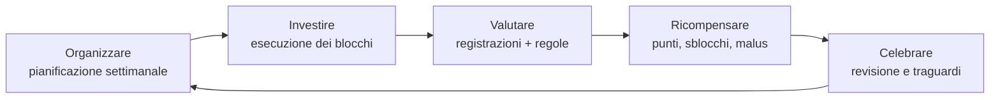

# 00a — Analisi del dominio

Primo passo del metodo: capire il problema **prima** di modellarlo. Qui si risponde alle sei domande (perché, chi, cosa, come, quando, dove); dalle risposte si estraggono le entità del [dizionario dei dati](00b-dizionario-dati.md).

**Fonti**: pagine Notion "Progetto Atomic", "100 days challenge", "Piano operativo" e database "Obiettivi 100 giorni". Le scelte fatte in sessione sono registrate in [decisioni.md](decisioni.md).

## Il problema in una frase

Si pianifica bene ma si esegue con poca costanza: il focus si perde, le attività si rinviano, il carico di scelte quotidiane porta a procrastinare o abbandonare.

## Perché

**Problema**: il calendario da solo registra *cosa* fare e *quando*, ma non aiuta a *farlo davvero*. Il punto debole non è l'organizzazione, è la gestione del tempo organizzato.

**Tesi**: se si collegano regole di gioco (ricompense e malus) alle attività pianificate nel tempo, il completamento aumenta e la pianificazione diventa più realistica.

**Come si verifica**: confronto tra un periodo senza gioco (Fase 0, misura di partenza) e un periodo con gioco attivo (Fase 1), sugli stessi tre osservabili:

| Osservabile | Cosa misura | Formula indicativa |
|---|---|---|
| **A — Completamento** | quanto di ciò che è pianificato viene fatto | attività completate / attività pianificate |
| **B — Accuratezza della stima** | quanto la durata prevista corrisponde a quella reale | durata reale / durata stimata |
| **C — Rinvii** | quanto spesso un'attività viene spostata | numero di rinvii per attività (e per settimana) |

Conseguenza per il design: il sistema deve **registrare i dati anche quando il gioco è spento**, altrimenti la Fase 0 non produce la misura di partenza.

## Chi

| Attore | Ruolo | Nella v1? |
|---|---|---|
| **Giocatore** | La persona che definisce obiettivi, pianifica, esegue e registra. Il prodotto è pensato per più giocatori; il primo è l'autore del progetto (primo tester, caso di studio "n = 1"). | Sì |
| **Calendari esterni** (Google, Apple) | Fonti e destinazioni di eventi già esistenti nella vita del giocatore. | Sì, come sistemi esterni |
| **Dispositivi di misura** (Apple Watch) | Producono registrazioni automatiche (passi, sonno). | Sì, come sistemi esterni |
| **Community** | Altre persone che seguono, consigliano, condividono. | No: fuori dalla v1 |

Conseguenza: dato che il prodotto è per altri, **regole, aree e punti devono essere personalizzabili** per giocatore ("customizzabile in base alle esigenze personali e di quel momento"). Nessun valore può essere scritto "a mano" pensando a un solo utente.

## Cosa

**Dentro il confine della v1**:
- gli **obiettivi**, classificati per **Area** (il perché), **Tipo** (come si gestiscono) e **Modalità** (quanta energia ricevono ora);
- i quattro tipi: **Progetto** (va in calendario), **Abitudine** (una spunta al giorno), **Contatore** (si accumula), **Ricompensa** (si sblocca);
- il **calendario**: blocchi di tempo che contengono attività elementari;
- le **registrazioni** (spunte, valori, incrementi) e i **rinvii**;
- le **regole** e i **punti** come concetti di dominio (cosa sono, non ancora come si calcolano);
- la **sfida** e le sue **fasi** (periodi con o senza gioco).

**Fuori dal confine (per ora)**: motore di calcolo dei punti, EXP e livelli, tokenomics, assistente IA, video e community, sincronizzazione dettagliata con i calendari esterni.

## Come

Il ciclo di vita del dominio ricalca i cinque verbi del tempo:

1. **Organizzare**: un giorno a settimana il giocatore assegna le attività ai blocchi del calendario (regola 7).
2. **Investire**: durante la giornata esegue i blocchi; prima e dopo possono esserci attività di contorno (regole 2 e 8).
3. **Valutare**: registra cosa ha fatto; le regole giudicano (es. blocco completato se x su y, regola 1).
4. **Ricompensare**: le regole assegnano punti o malus; i punti sbloccano ricompense.
5. **Celebrare**: chiusura serale e revisione settimanale; i traguardi grossi hanno una ricompensa dedicata.

Principio trasversale (dal Notion): **attrito positivo**. Un'attività non fatta non sparisce e non si spunta da sola: torna indietro e chiede una decisione.

## Quando

| Ciclo | Cosa succede |
|---|---|
| **Giorno** | mattina (30 minuti senza task, poi routine), blocchi, chiusura serale di 10 minuti (fatto, spostato, imparato, un grazie) |
| **Settimana** | pianificazione (domenica), minimi della settimana, revisione dei progressi |
| **Fase** | periodo con impostazioni di gioco proprie (Fase 0 senza gioco, Fase 1 gioco attivo, Fase 2 sessione d'esame) |
| **Sfida** | l'arco intero (100 giorni: dal 26/10/2026 al 02/02/2027) |
| **Scadenza** | la data entro cui un obiettivo va raggiunto |

## Dove

| Oggi (strumento fisico o Notion) | Compito | Nell'app diventa |
|---|---|---|
| Telefono | calendario con i blocchi | vista calendario e to-do list |
| Lavagnetta | griglia dei minimi della settimana | vista abitudini (spunte giornaliere) |
| Sughero | contatori e parete dei ricordi | vista contatori e traguardi |
| Taccuino tascabile | appunti rapidi | (fuori v1: sistema di note) |
| Apple Watch | passi e sonno | registrazioni automatiche |
| Notion | database degli obiettivi, revisione domenicale | gestione obiettivi e pianificazione |

La regola "uno strumento, un compito" suggerisce già la divisione in moduli dell'app.

## Dalle frasi alle entità (analisi grammaticale)

Tecnica usata per passare da questo documento al dizionario: si scrivono frasi semplici sul dominio e si sottolineano le parole.

- I **sostantivi** diventano entità candidate.
- Gli **aggettivi e le misure** diventano attributi.
- I **verbi** diventano relazioni o operazioni.

Esempi:

> Il **giocatore** *definisce* un **obiettivo** di **tipo** Progetto nell'**area** Studio, con **difficoltà** alta.

> Il giocatore *pianifica* un **blocco** di 2 ore che *contiene* tre **attività elementari**.

> Il blocco è *completato* se il giocatore *registra* almeno x **attività** su y.

> Se un'attività viene *rinviata* per la seconda volta, il giocatore *deve decidere*: la fa, la riduce o la toglie.

| Tipo di parola | Esempi estratti | Diventano |
|---|---|---|
| Sostantivi | giocatore, obiettivo, area, blocco, attività, registrazione, rinvio, regola, ricompensa, sfida, fase, routine | entità candidate |
| Aggettivi e misure | tipo, modalità, difficoltà, priorità, punti, durata stimata, scadenza, misura | attributi |
| Verbi | definire, pianificare, contenere, registrare, rinviare, completare, sbloccare | relazioni e operazioni |

## Glossario

Una parola, un significato. Quando due parole indicano la stessa cosa se ne sceglie una e l'altra va evitata.

| Termine | Definizione | Da evitare |
|---|---|---|
| **Giocatore** | La persona che usa il sistema. | utente (solo nei documenti tecnici) |
| **Area** | Uno dei grandi ambiti della vita a cui un obiettivo appartiene (il *perché*). | categoria |
| **Obiettivo** | Un traguardo misurabile che il giocatore vuole raggiungere. | goal, meta |
| **Tipo** | Come si gestisce un obiettivo: Progetto, Abitudine o Contatore. | — |
| **Modalità** | Quanta energia riceve ora un obiettivo: Spinta, Manutenzione, Parcheggio. | stato (ha un altro significato) |
| **Progetto** | Obiettivo che richiede tempo dedicato in calendario. | — |
| **Abitudine** | Obiettivo che si rispetta con una spunta ripetuta (ogni giorno o settimana). | — |
| **Contatore** | Obiettivo che si raggiunge accumulando unità nel tempo. | — |
| **Ricompensa** | Un premio da sbloccare, non un'attività. | premio |
| **Misura** | Il criterio con cui si capisce se un obiettivo è raggiunto (la "M" di SMART). | — |
| **Minimo** | La soglia garantita di un'abitudine (es. 2 L d'acqua). | target |
| **Attività** | L'unità di lavoro più piccola, che si spunta come fatta o non fatta. | task (solo nel codice) |
| **Blocco** | Un intervallo di tempo nel calendario che contiene una o più attività. | time block, evento |
| **Routine** | Un blocco che si ripete con le stesse attività (es. routine del mattino). | — |
| **Registrazione** | L'atto con cui il giocatore testimonia ciò che ha fatto: spunta, valore o incremento. | log, check |
| **Rinvio** | Lo spostamento di un'attività o di un blocco a un altro momento. | riprogrammazione |
| **Regola** | Una meccanica scelta dal giocatore: quando succede qualcosa, a una certa condizione, ha una conseguenza. | — |
| **Punti** | Il valore che le regole assegnano o tolgono. | — |
| **Sfida** | Un periodo con inizio e fine in cui il giocatore persegue un insieme di obiettivi. | — |
| **Fase** | Una parte della sfida con impostazioni di gioco proprie (gioco attivo sì o no). | — |
| **Attrito positivo** | Il sistema non completa né cancella da solo ciò che non è stato fatto: chiede una decisione. | — |
