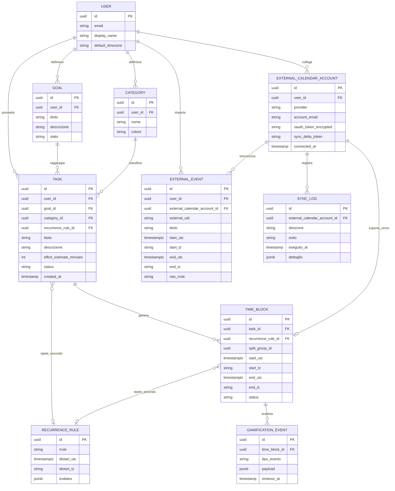

# 02 — Modello concettuale (ER)

> ⏸ **Bozza parcheggiata fino a S4** (06/11/2026): scritta prima dell'[analisi del dominio](00a-analisi-dominio.md). Va rifatta a partire dal [dizionario dei dati](00b-dizionario-dati.md): un blocco contiene più attività ([D-008](decisioni.md)), "Category" diventa "Area", l'obiettivo si specializza in Progetto, Abitudine e Contatore, e si aggiungono Routine, Registrazione, Rinvio, Regola, Ricompensa, Sfida e Fase.

## Diagramma entità-relazione

## Entità e attributi chiave

### User
Il proprietario dei dati. Ha un fuso orario di default (usato come fallback quando un client non lo specifica esplicitamente).

### Goal
Obiettivo di alto livello (es. "Superare l'esame di Algoritmi"). Raggruppa più Task. Ha uno stato proprio (es. `active`, `achieved`, `abandoned`) indipendente dallo stato dei singoli Task.

### Category / Tag
Classificazione libera dei Task (es. "Studio", "Lavoro", "Salute"), con colore per la UI.

### Task — il "cosa"
- `effort_estimate_minutes`: stima di sforzo dichiarata dall'utente.
- `status` (enum `TaskStatus`): `backlog` → `scheduled` → `completed` | `missed` → torna a `backlog`.
- `recurrence_rule_id` (nullable): **vedi decisione aperta sotto**.
- **Non ha mai** una data/ora di esecuzione propria: quella vive esclusivamente nel/nei Time Block collegati.

### Time Block — il "quando"
- `start_utc` / `end_utc`: timestamp assoluti UTC (vincolo non negoziabile, vedi [01-requisiti.md](01-requisiti.md)).
- `start_tz` / `end_tz`: ID fuso orario IANA al momento della creazione dell'evento.
- `task_id`: riferimento obbligatorio al Task che rappresenta.
- `split_group_id` (nullable): quando un Task viene spezzato in più Time Block, tutti i figli condividono lo stesso `split_group_id`, per poter ricostruire "questi N blocchi sono la stessa attività spezzata".
- `status` (enum `TimeBlockStatus`): `planned` → `completed` | `missed` | `rescheduled`.

### RecurrenceRule
- `rrule`: stringa RFC 5545 (es. `FREQ=WEEKLY;BYDAY=TU,TH;UNTIL=20261114`).
- `dtstart_utc` / `dtstart_tz`: ancora temporale della serie.
- `exdates`: eccezioni (date escluse dalla serie), in formato jsonb.
- **Non contiene mai** le occorrenze materializzate: quelle si calcolano a runtime (vedi [04-logica-di-business.md](04-logica-di-business.md)).

### ExternalCalendarAccount
Un collegamento OAuth a un provider esterno (Google, Apple/iCloud via CalDAV). Contiene il token cifrato e il `sync_delta_token` per la sincronizzazione incrementale (vedi [05-sync-calendari-esterni.md](05-sync-calendari-esterni.md)).

### ExternalEvent
Eventi importati da un calendario esterno che **non hanno un Task Atomic dietro** (es. un evento creato direttamente su Google Calendar dall'utente, non tramite l'app). Sono tenuti separati da `TimeBlock` per non mescolare dati "nativi" (con logica di split/attrito positivo/gamification) con dati "a specchio" puramente informativi.

### SyncLog
Traccia ogni operazione di sincronizzazione (direzione, esito, dettaglio) per diagnosi e audit.

### GamificationEvent
Payload grezzo emesso da un Time Block al verificarsi di una condizione (pianificazione anticipata, completamento puntuale, riprogrammazione ripetuta). Non contiene punteggio né logica di calcolo: è solo il contratto di interfaccia verso il futuro motore di gamification (vedi [04-logica-di-business.md](04-logica-di-business.md)).

## Enum di stato

**TaskStatus**: `backlog` → `scheduled` → `completed` | `missed` (torna a `backlog`).

**TimeBlockStatus**: `planned` → `completed` | `missed` | `rescheduled`.

## Decisione aperta da validare in questa milestone

**Dove agganciare `RecurrenceRule`: su `Task` o su `TimeBlock`?**

- **Su `Task`**: un Task ricorrente ("Palestra", lun/mer/ven) genera automaticamente una serie di Time Block quando pianificato. Più intuitivo lato utente ("questo impegno si ripete"), ma richiede una logica di "materializzazione" dei Time Block figli quando la serie viene pianificata la prima volta.
- **Su `TimeBlock`**: la ricorrenza descrive direttamente la griglia calendario, indipendentemente dal Task. Più vicino al modello di Google Calendar/iCalendar, ma rompe la netta separazione "Task = potenziale non temporale" se un singolo Task genera direttamente una serie.

Il diagramma sopra modella **entrambi** i collegamenti come possibili (FK nullable su entrambe le entità) proprio per non bloccare la scrittura degli altri documenti: la decisione finale va presa e registrata in [08-rischi-decisioni-aperte.md](08-rischi-decisioni-aperte.md) prima di chiudere la milestone M1, e da lì propagata a schema DB e logica di business.
