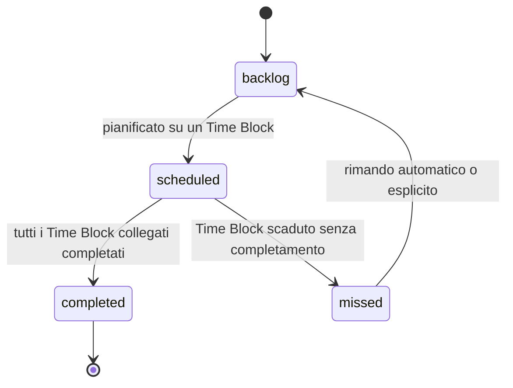
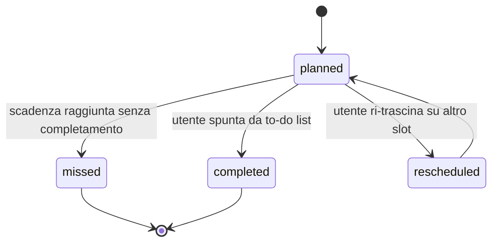

# 04 — Logica di business

> ⏸ **Bozza parcheggiata fino a S6** (06/11/2026): scritta prima dell'[analisi del dominio](00a-analisi-dominio.md). Da allineare a: blocco completato con soglia "x su y" ([D-008](decisioni.md)), rinvii secondo la regola 9 (domanda Q3 del [dizionario](00b-dizionario-dati.md)), calcolo degli osservabili A, B, C ([D-009](decisioni.md)).

## Motore RRULE

Le regole di ricorrenza (vedi [02-modello-concettuale.md](02-modello-concettuale.md) e [03-schema-database.md](03-schema-database.md)) **non vengono mai materializzate in righe separate**. Il motore applicativo espone una funzione concettuale:

```
espandi(regola: RecurrenceRule, range: [inizio, fine]) -> lista di occorrenze (start_utc, end_utc)
```

- L'espansione avviene **solo su richiesta di una vista** (es. "mostrami la settimana dal 12 al 18 ottobre").
- Il risultato si può cachare a livello di vista/range richiesto (es. cache per settimana calendario per utente), invalidata quando la regola o le sue eccezioni (`exdates`) cambiano.
- Le eccezioni (una singola occorrenza spostata o cancellata) si gestiscono con il pattern iCalendar `RECURRENCE-ID` — vedi nota in [08-rischi-decisioni-aperte.md](08-rischi-decisioni-aperte.md), da definire nel dettaglio in questa milestone.

## State machine

### Task



### Time Block



Un Task passa a `completed` solo quando **tutti** i suoi Time Block (incluso lo split) sono `completed`; se anche uno solo è `missed`, il Task torna in `backlog` per essere ripianificato (coerente con la regola dell'attrito positivo, RF-05).

## Algoritmo di split di un Task

Input: un Task con `effort_estimate_minutes`, e l'insieme degli slot liberi nel range scelto dall'utente (calcolato come complemento dei Time Block già pianificati).

1. Se esiste uno slot libero singolo ≥ `effort_estimate_minutes`: si crea **un solo** Time Block, `split_group_id = NULL`.
2. Se non esiste, il sistema propone una combinazione di slot più piccoli la cui somma copre l'effort stimato (algoritmo greedy: riempie prima gli slot più capienti, poi i residui), e crea **N Time Block** che condividono lo stesso `split_group_id` generato ex novo.
3. L'utente può sempre rifiutare la proposta automatica e posizionare manualmente i singoli Time Block figli.
4. Vincolo di coerenza: `SUM(durata Time Block per uno split_group_id) `deve rimanere allineata a `effort_estimate_minutes` del Task padre (con una tolleranza di UX da definire, es. ±10%); scostamenti maggiori vanno segnalati in UI, non bloccati.

## Regola dell'attrito positivo (RF-05)

Trigger: allo scadere di `end_utc` di un Time Block ancora in stato `planned`.

- Il sistema **non** lo marca automaticamente `completed`.
- Il sistema **non** lo cancella.
- Transizione automatica a `missed`.
- Conseguenza sul Task: se era l'unico/ultimo Time Block del Task, il Task torna in `backlog`; se il Task ha altri Time Block ancora `planned` (caso split), resta `scheduled` finché non si esauriscono anche quelli.
- La UI deve rendere visibile e "scomodo" lo stato `missed` (vedi [06-ux-ui.md](06-ux-ui.md)) per forzare una decisione esplicita dell'utente, non un semplice batch silenzioso.

## Contratto degli eventi verso la gamification

Questa fase **non** implementa la logica di calcolo di punti/livelli/token. Definisce solo il contratto di interfaccia, coerente con la tabella `gamification_events` di [03-schema-database.md](03-schema-database.md), tramite un pattern **outbox/event bus**: ogni transizione di stato rilevante scrive un evento immutabile, che un consumer futuro (il motore di gamification, oggi `Glitch mark1`) potrà leggere e processare in modo asincrono e disaccoppiato.

| Evento | Trigger | Payload minimo |
|--------|---------|-----------------|
| `PlanningAheadEvent` | L'utente pianifica in anticipo (es. la domenica sera alloca tutti i Task della settimana successiva nei Time Block) | `user_id`, `settimana_riferimento`, `numero_task_pianificati` |
| `OnTimeCompletionEvent` | Un Time Block viene completato esattamente entro la propria finestra `[start_utc, end_utc]` | `time_block_id`, `task_id`, `durata_effettiva_vs_stimata` |
| `RepeatedRescheduleWarning` | Un Time Block (o i suoi discendenti nello stesso `split_group_id`) viene riprogrammato per 3 giorni consecutivi | `task_id`, `numero_riprogrammazioni`, `ultimo_reschedule_at` |

Il consumer di questi eventi è fuori scope di questo documento: qui si garantisce solo che il dato necessario esista e sia emesso in modo affidabile (outbox pattern: scrittura dell'evento nella stessa transazione della transizione di stato, per evitare eventi persi).

## Regole drag & drop

- **Creazione**: trascinare un Task dal backlog su uno slot libero crea un Time Block con `start_utc`/`end_utc` derivati dallo slot, `status = planned`.
- **Snapping**: lo slot si aggancia a una griglia minima configurabile (es. 15 minuti), per evitare Time Block con orari "sporchi".
- **Overlap**: di norma non sono permessi due Time Block sovrapposti per lo stesso utente; l'eccezione (se necessaria) va segnalata come decisione aperta in [08-rischi-decisioni-aperte.md](08-rischi-decisioni-aperte.md).
- **Riprogrammazione**: trascinare un Time Block esistente su un altro slot lo porta a `rescheduled` e poi di nuovo a `planned` sul nuovo slot, incrementando il contatore di riprogrammazioni usato da `RepeatedRescheduleWarning`.

## Conflict resolution locale ↔ backend

Proposta v1 (da validare, vedi [08-rischi-decisioni-aperte.md](08-rischi-decisioni-aperte.md)): **version/etag + last-write-wins** sul singolo record (`tasks` o `time_blocks`). Ogni riga porta una `version` incrementale; il backend rifiuta un push con `version` non allineata e restituisce la versione corrente, lasciando al client la scelta se sovrascrivere o unire manualmente. Non si prevede, in questa fase, un merge automatico di campi (troppo rischioso su dati temporali) — solo rilevamento del conflitto ed esposizione all'utente quando serve.
