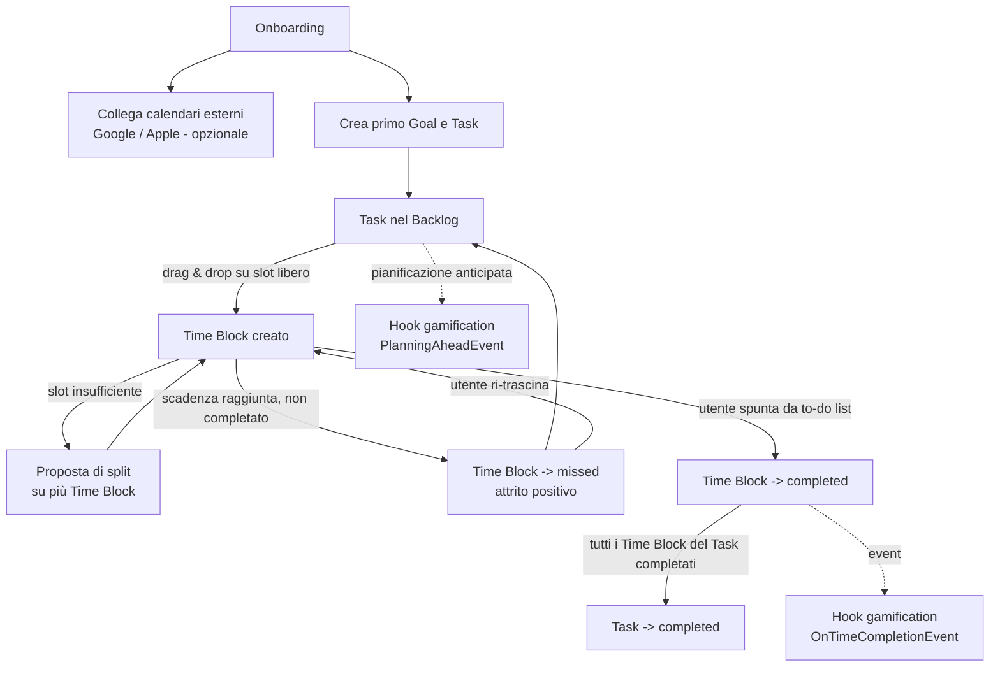

# 06 — UX/UI

> ⏸ **Bozza parcheggiata fino a S7** (06/11/2026): scritta prima dell'[analisi del dominio](00a-analisi-dominio.md). In S7 si riprende solo per le storie della prima fetta, aggiungendo le viste per abitudini e contatori (la "lavagnetta" e il "sughero").

## User flow principali

## Le due viste

### Vista calendario / timeblocking

- Griglia oraria (giorno/settimana), con **sidebar laterale** che mostra il backlog dei Task non pianificati.
- Trascinamento diretto di un Task dalla sidebar a uno slot della griglia.
- I Time Block mostrano titolo, categoria (colore), durata; lo stato `missed` è visivamente distinto (es. bordo tratteggiato o colore di allerta), mai semplicemente rimosso dalla vista.
- Le occorrenze ricorrenti (RRULE espansa lato client per il range visibile) sono visivamente indistinguibili da un Time Block singolo, salvo un'icona di ricorrenza.

### Vista to-do list

- Lista per giorno, con checkbox per ogni Time Block/Task pianificato in quel giorno.
- Spuntare la checkbox = completamento (transizione `planned` → `completed`).
- I Task ancora nel backlog (senza Time Block) sono raggruppati separatamente, non mescolati con quelli già pianificati.

Le due viste leggono/scrivono **sullo stesso modello dati** (Task + Time Block): non sono due sotto-sistemi separati.

## Responsive

- **Mobile**: la to-do list è la vista primaria (ottimizzata per touch, spuntare rapidamente); la vista calendario resta accessibile ma secondaria.
- **Desktop/Web**: la vista calendario con sidebar drag & drop è la vista primaria, più adatta a mouse/tastiera e schermi larghi.

## Micro-interazioni

- **Drag & drop**: feedback visivo immediato dello slot di destinazione (snapping alla griglia, anteprima della durata prima del rilascio).
- **Stato `missed`**: badge visivo non ignorabile (es. nella to-do list del giorno successivo, finché l'utente non decide se rimandare o ripianificare).
- **Riprogrammazioni ripetute**: se un Time Block (o il suo `split_group_id`) viene riprogrammato per 3 giorni consecutivi, l'interfaccia lo segnala (coerente con `RepeatedRescheduleWarning`, vedi [04-logica-di-business.md](04-logica-di-business.md)) — es. un'icona di attenzione che invita l'utente a frammentare ulteriormente il Task o a rivalutarne la fattibilità, senza però bloccare l'azione.
- **Split proposto automaticamente**: quando il sistema propone di spezzare un Task, l'utente vede chiaramente quali sono gli slot proposti prima di confermare, e può modificarli manualmente.
